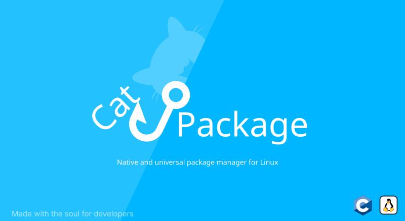

# 🌊 CatPackage 📦

---

CatPackage is a native, minimalist package management system designed for building and maintaining minimal Linux environments.

It is distribution-independent and provides its own `.catpackage` package format, package metadata specification, build tools, and bootstrap environment.

CatPackage currently supports **x86_64** and **aarch64** architectures.

> [!WARNING]
> At the moment, the project is in beta testing and may contain both errors and shortcomings, but active development is underway.

---

| Component | Description |
| --- | --- |
| **[catpkg](https://raw.githubusercontent.com/ModuDevCore/CatPackage/refs/heads/main/DOCS/catpkg-cli)** | Native package manager and command-line interface. |
| **[catpkg-make](https://github.com/ModuDevCore/catpkg-make)** | Build system for CatPackage packages and project components. |
| **[catstrap](https://raw.githubusercontent.com/ModuDevCore/CatPackage/refs/heads/main/DOCS/catstrap-cli)** | Bootstrap environment for installing and managing primary CatPackage packages. |
| **[CATPKG DSL](https://raw.githubusercontent.com/ModuDevCore/CatPackage/refs/heads/main/DOCS/CATPKG_DSL)** | CATPKG package metadata format and specification. |

## < Key Features >

* **Native C implementation.**
* **x86_64 and aarch64 support.**
* **Distribution-independent package management.**
* **Independent bootstrap environment.**
* **Package installation, removal, updating and verification.**
* **Transactional package operations with rollback support.**
* **Own `.catpackage` package format.**
* **CATPKG package metadata specification.**
* **Designed for minimal Linux environments.**
* **Package and utility build system.**

---

## 🚀 Quick Start

### < Installation >

**Option 1 — catstrap** *(Recommended)*

Download the latest catstrap build from the [CatPackage releases](https://github.com/ModuDevCore/CatPackage/releases).

Select the build corresponding to your processor architecture and installation requirements.

```bash
sudo catstrap-catpkg-* --install
```

For catstrap usage and available installation options, see:

**[DOCS/catstrap-cli](https://raw.githubusercontent.com/ModuDevCore/CatPackage/refs/heads/main/DOCS/catstrap-cli)**


**Option 2 — catpkg package**

If `catpkg` or a compatible CatPackage bootstrap environment is already available, download the latest `.catpackage` from the [CatPackage releases](https://github.com/ModuDevCore/CatPackage/releases):

```bash
sudo catpkg install catpkg-(x86_64/aarch64)@X.X.X.catpackage
```

To update an existing installation:

```bash
sudo catpkg update catpkg-(x86_64/aarch64)@X.X.X.catpackage
```

For the complete catpkg command-line interface, see:

**[DOCS/catpkg-cli](https://raw.githubusercontent.com/ModuDevCore/CatPackage/refs/heads/main/DOCS/catpkg-cli)**


**Option 3 — Build from source**

Clone the repository:

```bash
git clone https://github.com/ModuDevCore/CatPackage.git
cd CatPackage
```

Run the `catpkg-make` executable corresponding to the host architecture:

```bash
./catpkg-make-x86_64
```

or:

```bash
./catpkg-make-aarch64
```

Then select the required build and target architecture from the interactive menu.

For additional information about available builds, see:

**[DOCS/catpkg-make](https://github.com/ModuDevCore/catpkg-make)**

---

## 📖 Documentation

### RAW DOCS

- [DOCS/catpkg-make](https://github.com/ModuDevCore/catpkg-make)
- [DOCS/CATPKG-DSL](https://raw.githubusercontent.com/ModuDevCore/CatPackage/refs/heads/main/DOCS/CATPKG-DSL)
- [DOCS/catpkg-cli](https://raw.githubusercontent.com/ModuDevCore/CatPackage/refs/heads/main/DOCS/catpkg-cli)
- [DOCS/catstrap-cli](https://raw.githubusercontent.com/ModuDevCore/CatPackage/refs/heads/main/DOCS/catstrap-cli)

The documentation can also be viewed using `catpkg-docs` where available.

Available documentation includes:

```text
catpkg-docs catstrap
catpkg-docs make
catpkg-docs catpkg
catpkg-docs CATPKG
```

---

## < Environment Variables >

### `CATPKG_VERBOSE`

Enables verbose diagnostic output for supported CatPackage utilities.

Example:

```bash
CATPKG_VERBOSE=1 catpkg ...
```

With `sudo`:

```bash
sudo CATPKG_VERBOSE=1 catpkg ...
```

This variable is intended primarily for debugging and diagnostic output.

---

## < Package Format >

CatPackage uses the `.catpackage` package format.

A package name generally follows the form:

```text
package-(architecture)@version.catpackage
```

Example:

```text
catpkg-x86_64@2.0.0b.catpackage
```

Package metadata and filesystem information are described using the CATPKG specification.

See:

**[DOCS/CATPKG-DSL](https://raw.githubusercontent.com/ModuDevCore/CatPackage/refs/heads/main/DOCS/CATPKG-DSL)**

---

## < Architectures >

Currently supported target architectures:

```text
x86_64
aarch64
```

Architecture-independent packages may omit the architecture designation where applicable.

---

## 🤝 Contributing

Contributions are welcome.

Please read **[TECHNICAL.md](https://raw.githubusercontent.com/ModuDevCore/CatPackage/refs/heads/main/DOCS/TECHNICAL.md)** before submitting a Pull Request.

When contributing changes to package handling, metadata parsing, the build system, or package operations, make sure the corresponding documentation is updated where applicable.

---

### Acknowledgements

This project uses the [SHA-256 implementation by LekKit](https://github.com/LekKit/sha256), licensed under the MIT License.

---

**Made with ❤️ for better Linux development**